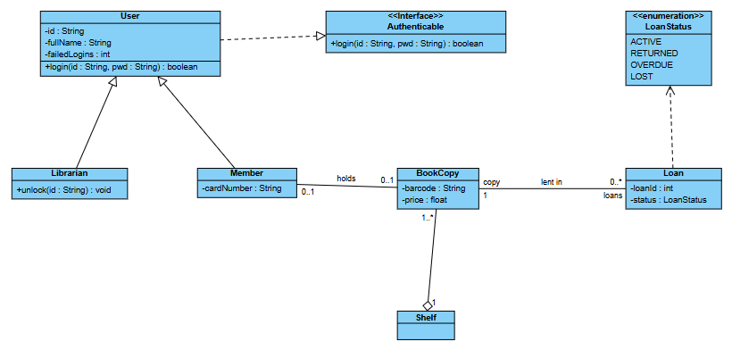
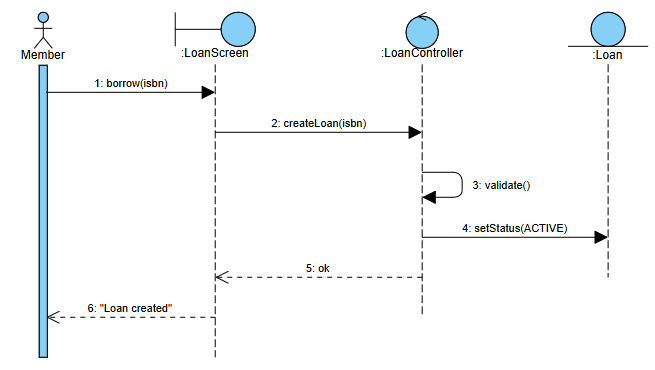
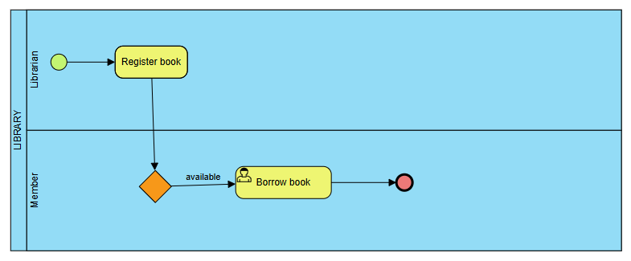

# vp-online-mcp

[](https://github.com/ibsorn/vp-online-mcp/actions/workflows/ci.yml)
[](https://www.npmjs.com/package/vp-online-mcp)
[](LICENSE)


**English** · [Español](README.es.md)

An [MCP](https://modelcontextprotocol.io) server that lets an AI agent (Claude Code, Claude Desktop,
Cursor, VS Code or any MCP client) draw **native, editable** diagrams in
[Visual Paradigm Online](https://online.visual-paradigm.com): class, use case, activity, sequence,
state, component, deployment, package, ER, DFD, BPMN, flowcharts, org charts, mind maps, and any
other shape in VP's library. **A whole diagram is one tool call.**

What it creates is the same thing you would get drawing by hand in VP:
real classes with attributes and operations, associations with multiplicities and roles,
ER tables with PK/FK columns, ordered sequence messages, BPMN lanes. Everything lives in VP's
model, stays editable in VP, and is saved to your VP cloud.



> Unofficial project, not affiliated with or endorsed by Visual Paradigm. It drives the VP Online
> web editor in a browser with **your own account**; use it according to VP's terms of service.

---

## Contents
1. [Quick start](#quick-start)
2. [How the agent works](#how-the-agent-works)
3. [Tools](#tools)
4. [`vp_build` conventions](#vp_build-conventions)
5. [Diagram types and examples](#diagram-types-and-examples)
6. [Design: how it saves tokens](#design-how-it-saves-tokens)
7. [Architecture](#architecture)
8. [Configuration](#configuration)
9. [Troubleshooting](#troubleshooting)
10. [Known limitations](#known-limitations)
11. [Development and tests](#development-and-tests)

---

## Quick start

**Requirements:** Node.js 20+, Google Chrome or Microsoft Edge, and a
[Visual Paradigm Online](https://online.visual-paradigm.com) account (needed to save).

### 1. Add the server to your MCP client

**Claude Code**

```bash
claude mcp add vp-online -s user -- npx -y vp-online-mcp
```

On Windows, wrap `npx` with `cmd /c`:

```bash
claude mcp add vp-online -s user -- cmd /c npx -y vp-online-mcp
```

**Claude Desktop** (`claude_desktop_config.json`), **Cursor** (`~/.cursor/mcp.json`) and most
other clients:

```json
{
  "mcpServers": {
    "vp-online": {
      "command": "npx",
      "args": ["-y", "vp-online-mcp"]
    }
  }
}
```

On Windows use `"command": "cmd"` and `"args": ["/c", "npx", "-y", "vp-online-mcp"]`.

**VS Code** (`.vscode/mcp.json`):

```json
{
  "servers": {
    "vp-online": { "type": "stdio", "command": "npx", "args": ["-y", "vp-online-mcp"] }
  }
}
```

**Latest commit from GitHub** instead of npm: replace `vp-online-mcp` with
`github:ibsorn/vp-online-mcp` (the first start clones and installs it, which takes longer).

**From a clone** (for development): `git clone`, `npm install`, then point the client at
`node /path/to/vp-online-mcp/server.js`.

### 2. Log in once

The first tool call opens a **dedicated Chrome window** with its own profile, separate from your
everyday browser. Log in to Visual Paradigm Online there **once**; the session is kept in
`~/.vp-online-mcp/chrome-profile`.

### 3. Ask for diagrams

> *"Create in VP the class diagram of a library system: User, Member, Librarian, BookCopy and
> Loan with their attributes, inheritance and associations with multiplicities. Then save it as
> 'Library model'."*

Without a session you can still build diagrams, but not save them: `vp_open` warns
`NOT SIGNED IN`.

## How the agent works

```
vp_open {type}  →  vp_build {elements, connectors}  →  vp_inspect  →  vp_save {name}
                     (whole diagram, 1 call)          (verify)        (VP cloud)
```

- Later changes: `vp_edit` with many operations in one call.
- To look at the result: `vp_screenshot {path}` writes a PNG and costs no image tokens.
  Without `path` it returns the image.
- The conventions reach the model **once**, in the server `instructions`; tool descriptions are
  one line each.

## Tools

| Tool | What it does | MCP annotations |
|---|---|---|
| `vp_open {type?, url?}` | Opens a new diagram (`type`) or an existing one (`url`). No arguments: describes the current one. Returns the palette ids. | non-destructive |
| `vp_shapes {query?, limit?}` | No `query`: the diagram's palette. With `query`: searches **all** of VP's shape library; results are usable in `vp_build`. | read-only |
| `vp_build {elements?, connectors?, layout?, columns?, clear?}` | Creates many elements and connectors at once. If one item fails it carries on and reports it. | destructive (because of `clear`) |
| `vp_edit {ops}` | Batched changes (see the next table). | destructive |
| `vp_inspect {ref?, filter?, detail?, limit?}` | Compact listing of the diagram. | read-only |
| `vp_save {name?}` | Saves to the VP cloud. On an already saved diagram, a different `name` saves a copy. | non-destructive, idempotent |
| `vp_screenshot {path?, ref?, scale?}` | Image cropped to the content, or to one element with `ref`. | read-only |
| `vp_eval {code}` | Escape hatch: runs JS in the editor with an `api` object. | destructive |

### `vp_edit` operations

| `op` | Fields | Effect |
|---|---|---|
| `label` | `ref`, `text` | Renames an element or connector. |
| `move` | `ref`, `x`, `y` | Moves the element. |
| `resize` | `ref`, `w`, `h` | Resizes it. |
| `rows` | `ref`, `rows`, `rowAction?` | Adds rows (attributes, operations, columns…). |
| `removeRows` | `ref`, `match?` (regex) | Removes rows; without `match`, all of them. |
| `ends` | `ref`, `mult?`, `roles?` | Multiplicities and roles `[from, to]` of a connector. |
| `style` | `ref`, `style` | mxGraph style, e.g. `fillColor=#FFF2CC;`. |
| `delete` | `ref` | Deletes the element and its connectors. |
| `add` | element fields | Adds an element. |
| `connect` | connector fields | Adds a connector. |
| `layout` | `kind` | Arranges the diagram: `grid`, `hierarchical`, `horizontal`, `organic` or `tree`. The hierarchical ones route the connectors; the others clear their waypoints. |
| `fit` | `ref` | Fits the size to the text. |

### `vp_inspect` format

```
"Untitled" ClassDiagram | 8 elements, 7 connectors | unsaved
#1 Class "User" @60,40 252x91 [-id : String; -fullName : String; -failedLogins : int; +login(id : String, pwd : String) : boolean]
#7 Interface "Authenticable" @460,40 252x58 [+login(id : String, pwd : String) : boolean]
#10 Generalization Member -> User
#12 Association Member{0..1} -> BookCopy{0..1} "holds"
#15 Association BookCopy{1,role=copy} -> Loan{0..*,role=loans} "lent in"
```

- `#id` is a short id that every tool accepts as `ref`. Keys and labels work too.
- The type shown is the same palette id `vp_build` uses.
- Connectors are listed **in the direction they were created**.
- `detail:"brief"` drops coordinates and summarises rows as `(9 rows)`.
- `filter` and `ref` narrow the output.
- `limit` caps the number of lines (150 by default) and says how to narrow down when it truncates.

## `vp_build` conventions

**Element**: `{shape, label?, key?, x?, y?, w?, h?, parent?, rows?, rowAction?, style?}`

- `shape` is the palette id, e.g. `Class`, `Actor`, `UseCase`, `System`, `Entity`, `DeviceNode`,
  `Action` or `Lifeline`. See `vp_open` or `vp_shapes`.
- `key` is the name `from`, `to` and `parent` refer to. Without it, refer to the label.
- **Position**: without `x` and `y`, the element is auto-placed on a grid without overlaps. With a
  `parent` it is placed **inside** the container, which grows to fit. Coordinates are pixels; a
  child's are relative to its parent.
- **`rows`**: the server decides which compartment each row goes to:
  - In a class or interface, a row with `(` is an operation; the rest are attributes.
  - In ER, a row is `"name type"`, optionally prefixed with `PK `, `FK ` or `PK,FK `.
  - Other shapes use `rowAction` (`addTrigger`, `addProcedure`, `addClause`…); if it is missing,
    the error lists the options.
  - A row can also be `{text, action?, set?}`. `set` writes model XML attributes, e.g.
    `{"nullable":"false"}`.
- **Activity swimlanes**: in `VerticalSwimlane` and `HorizontalSwimlane`, `rows` are the partition
  names. The two template partitions are renamed, extra ones removed, and each additional name adds
  a partition (a column in `VerticalSwimlane`). VP only adds vertical partitions to a
  `HorizontalSwimlane`, which makes a grid: for N lanes use `VerticalSwimlane`.
- **Attached shapes** (`Port`, `InputPin`, `OutputPin`, `ActivityParameterNode`, `Lane`) need a
  `parent`: ports and pins go on the parent's border, lanes stack inside the pool.
- `label: ""` clears a default name, such as the text "DecisionNode".

**Connector**: `{shape, from, to, label?, mult?, roles?, y?, points?, key?, style?}`

- **Direction**: the arrowhead is always at **`to`**.
  - Generalization: `from` is the subclass, `to` the superclass.
  - Realization: `from` is the implementing class.
  - Include and Extend: `from` is the base use case.
- In Aggregation and Composition the diamond is at **`from`** (the whole).
- `mult` and `roles` are `[from, to]`, e.g. `"mult": ["1", "0..*"]`.
- **Sequence**: messages stack top-down in the order given; `y` places one explicitly.
  `SelfMessage` draws a loop with its label beside it, and lifelines grow as needed.
- `points` are waypoints `[[x,y],…]`.
- Two connectors between the same elements are fanned out automatically so they do not overlap
  (not for sequence messages or connectors with `points`).
- Connector texts are kept readable: the name sits beside the line (above it when horizontal), and
  each end's multiplicity and role go on opposite sides of the line. Texts you moved by hand are
  left alone.

**Errors** are actionable, for example:
- `unknown shape "Clas". Did you mean: Class?`
- `"Solo" is ambiguous (#3, #4): use one of these #ids`
- `Port must be attached to a parent element (set parent)`

Minimal example (a class diagram in one call):

```json
{
  "elements": [
    {"shape": "Class", "label": "BookCopy", "rows": ["-barcode : String", "-price : float"]},
    {"shape": "Class", "label": "Loan", "rows": ["-loanId : int", "+close() : void"]}
  ],
  "connectors": [
    {"shape": "Association", "from": "BookCopy", "to": "Loan", "label": "lent in", "mult": ["1", "0..*"]}
  ]
}
```

## Diagram types and examples

Each type has a complete, **tested** example in [`examples/`](examples); the e2e suite runs
exactly those files.

| `type` | Key shapes | Key connectors | Example |
|---|---|---|---|
| `ClassDiagram` | Class, Interface, Enumeration, Package, Note | Generalization, Realization, Association, Aggregation, Composition, Dependency, Usage | [class.json](examples/class.json) |
| `UseCaseDiagram` | Actor, UseCase, System | Association, Include, Extend, Generalization | [usecase.json](examples/usecase.json) |
| `ActivityDiagram` | InitialNode, Action, DecisionNode, MergeNode, ForkNode, JoinNode, ActivityFinalNode, InputPin/OutputPin, VerticalSwimlane | ControlFlow, ObjectFlow | [activity.json](examples/activity.json) |
| `SequenceDiagram` | Actor, Lifeline, BoundaryLifeline, ControlLifeline, EntityLifeline, LoopCombinedFragment | Message, ReplyMessage, SelfMessage, CreateMessage | [sequence.json](examples/sequence.json) |
| `StateMachineDiagram` | InitialPseudoState, State, Choice, FinalState | Transition | [state.json](examples/state.json) |
| `ComponentDiagram` | Component, Interface, Port | Usage, Realization, Dependency | [component.json](examples/component.json) |
| `DeploymentDiagram` | Node, DeviceNode, ExecutionEnvironmentNode, Artifact, Component | Link, Dependency, Deployment | [deployment.json](examples/deployment.json) |
| `PackageDiagram` | Package, Subsystem | Dependency, Import, Access, Merge | [package.json](examples/package.json) |
| `ERDiagram` | Entity, View, Triggers, StoredProcedures | OnetoOneRelationship, OnetoManyRelationship, ManytoManyRelationship | [er.json](examples/er.json) |
| `DataFlowDiagram` | Process, ExternalEntity, DataStore | DataFlow, BidirectionalDataFlow | [dfd.json](examples/dfd.json) |
| `BusinessProcessDiagram` | HorizontalPool, Lane, StartEvent, Task, UserTask, gateways, EndEvent | SequenceFlow, MessageFlow | [bpmn.json](examples/bpmn.json) |
| `Flowchart` | Start, Process, Decision, Data, Terminator… | FlowLine | [flowchart.json](examples/flowchart.json) |
| `OrganizationChart` | Unit | Line | [orgchart.json](examples/orgchart.json) |
| `MindMapDiagram` | Node | Branch | [mindmap.json](examples/mindmap.json) |

Any other VP diagram type opens with its `type` too, and `vp_shapes {query}` finds any shape in
its library.

| Sequence | BPMN |
|---|---|
|  |  |

## Design: how it saves tokens

The design follows the practices published by Anthropic and the MCP specification, and what the
most used MCP servers do ([sources](#sources)).

| Practice | How it is applied |
|---|---|
| **Few tools with distinct purposes that cover whole workflows** | 8 tools instead of one per action. `vp_build` creates a whole diagram in one call. `vp_open` replaces three tools (new, open, status) and `vp_shapes` two (palette, search). |
| **Shared context once** | Conventions live in the server `instructions`; tool descriptions are one line. |
| **Small, flat schemas** | One `rows` field instead of `attributes`, `operations`, `columns` and `members`. `mult` and `roles` as `[from, to]`. No `$schema` or default metadata in the listing; annotations are sent only when they differ from the defaults. |
| **Compact, meaningful responses** | Short ids (`#12`) and connectors with readable names. `vp_build` returns one line per group and never echoes the diagram. |
| **Selectable response format** | `vp_inspect` `detail:"brief"`, `filter`, `ref` and `limit`; when output is truncated it says how to narrow it. |
| **Actionable errors** | "Did you mean" suggestions, the list of `#id`s on ambiguity, missing fields and the valid row action. |
| **Images only when needed** | `vp_screenshot {path}` writes the PNG and returns only the path. |
| **"Code mode" escape hatch** | `vp_eval` filters or aggregates inside the page and returns only the result. |
| **Robustness** | Calls run one at a time with timeouts, retry if VP reloads the page, and an expired session is detected. |

Fixed cost measured with `npm run measure`: **8 tools + instructions ≈ 1,600 tokens**.

Measured performance:

| Case | Time |
|---|---|
| Class diagram (8 classes, 7 relationships) | ~0.6 s |
| 40 classes, 320 rows, 45 relationships (60 multiplicities) | ~5–12 s depending on machine load |

How: each build phase runs in **one model transaction**, rendering and the format panel are paused
while working, and rows are written without going through the inline text editor.

## Architecture

```
server.js        MCP over stdio: 8 tools, instructions, queue, timeouts, errors
lib/browser.js   Dedicated Chrome (own profile, CDP on port 9333) that survives MCP restarts
lib/vp.js        Tab lifecycle, injection, workspace, save, screenshots
lib/page-api.js  API injected into the VP editor (mxGraph); does all the work
examples/        One example diagram per type (also the e2e test data)
test/            e2e.js (acceptance suite), smoke.js (offline, CI), measure.js, client.js
scripts/eval.js  Debug helper: evaluates JS in the editor tab
```

**Why the result is native:** `page-api.js` uses VP's own code paths instead of drawing loose cells:

| To… | It uses… |
|---|---|
| Create shapes | Each palette item's `mxDragSource.drop()` (like dragging it). |
| Create connectors and attached shapes | The palette template (`getCell()`) plus `connectCell`. |
| Create rows | The "Add X" methods behind VP's context menu. |
| Rename | `graph.labelChanged`. |

**Resilient to VP updates:** VP's code is minified, so the server never hard-codes an internal name:
- `EditorUi` and `Graph` instances are captured on the fly.
- Palette metadata is recognised by its shape.
- "Add X" methods are discovered by reading the menu code (`mxResources.get("addAttribute")…`).
- Each cell's type is read from `origin.paletteItemUiId`, which VP stores in the model.

## Configuration

| Variable | Default | Use |
|---|---|---|
| `CHROME_PATH` | auto-detected | Path to Chrome or Edge. |
| `VP_MCP_PORT` | `9333` | CDP port of the dedicated Chrome. |
| `VP_MCP_PROFILE` | `~/.vp-online-mcp/chrome-profile` | Profile that keeps the VP session. |
| `VP_WORKSPACE` | auto-detected | VP workspace id (the `<ws>` in `online.visual-paradigm.com/w/<ws>/`). Remembered in `~/.vp-online-mcp/state.json`. |
| `VP_MCP_HEADLESS=1` | off | Chrome without a window. Only useful once the session is logged in. |

## Troubleshooting

| Symptom | Fix |
|---|---|
| `NOT SIGNED IN`, or `vp_save` says there is no session | The VP session expired. Log in again in the MCP Chrome window and repeat `vp_open`. |
| `No diagram is open` | Call `vp_open {type}` or `vp_open {url}`. |
| `unknown shape "X"` | Use one of the ids the error suggests, or search with `vp_shapes {query}`. |
| The Chrome window was closed | The next call reopens it with the same session. |
| `Chrome not found` | Install Chrome or Edge, or set `CHROME_PATH`. |
| `Could not attach to the VP editor` | Reload the tab. If it persists, VP changed its internals: please [open an issue](https://github.com/ibsorn/vp-online-mcp/issues). |
| A very large `vp_build` times out (5 min) | Split it into several calls. `vp_inspect` shows what was already applied. |

## Known limitations

- **Saving needs a session.** VP expires sessions after some hours; log in again when told.
- **Sequence diagrams:** messages do not create activation bars. It is still valid UML; add them in
  VP if you want them.
- **Auto-layout** uses mxGraph's algorithms and does not route lines around obstacles. For polished
  diagrams give explicit `x`/`y`.
- **Shape search:** result ids (`Decision10`…) are generated by VP and may change. `vp_build` also
  accepts the title, e.g. `"Decision"`.
- **Unofficial:** it relies on VP Online's web editor. A VP update can break something until this
  project adapts; the e2e suite exists to detect it fast.

## Development and tests

```bash
npm run check        # offline smoke test (no browser): tools, schemas, examples, metadata
npm test             # full e2e suite against VP Online, without saving (~2–5 min)
npm run test:save    # also save, re-save, save a copy and reopen (creates 2 diagrams in your cloud)
npm test -- class er # only those suites
npm run measure      # token cost of the tool definitions
```

The **e2e** suite (`test/e2e.js`) drives the real server over stdio against VP Online and checks
concrete results: the 14 diagram types, every `vp_edit` operation, `vp_inspect` modes and
screenshots, the five auto-layouts without overlaps, errors and their messages, shape search,
concurrent calls, save/copy/reopen/edit after reload, and a stress case (40 classes, 320 rows,
45 relationships). Last result: **220/220** including saving. Screenshots of every diagram are
written to `test/out/` for visual review.

See [CONTRIBUTING.md](CONTRIBUTING.md), [SECURITY.md](SECURITY.md) and [CHANGELOG.md](CHANGELOG.md).

## Sources

- Anthropic, [Writing effective tools for agents](https://www.anthropic.com/engineering/writing-tools-for-agents):
  consolidating tools, concise or detailed responses, meaningful ids, actionable errors, pagination
  and truncation.
- Anthropic, [Code execution with MCP](https://www.anthropic.com/engineering/code-execution-with-mcp):
  progressive disclosure and filtering data inside the execution environment.
- [MCP specification: Tools](https://modelcontextprotocol.io/specification/2025-06-18/server/tools):
  annotations and `isError` results.
- bump.sh, [4 rules to build an efficient MCP server](https://bump.sh/blog/4-rules-to-build-an-efficient-mcp-server).
- Cloudflare, [Code Mode](https://blog.cloudflare.com/code-mode/): a small search/execute surface
  instead of thousands of tools.
- Playwright MCP, [snapshots](https://playwright.dev/mcp/snapshots): structured text instead of
  screenshots.

## License

[MIT](LICENSE). Visual Paradigm is a trademark of its respective owner.
